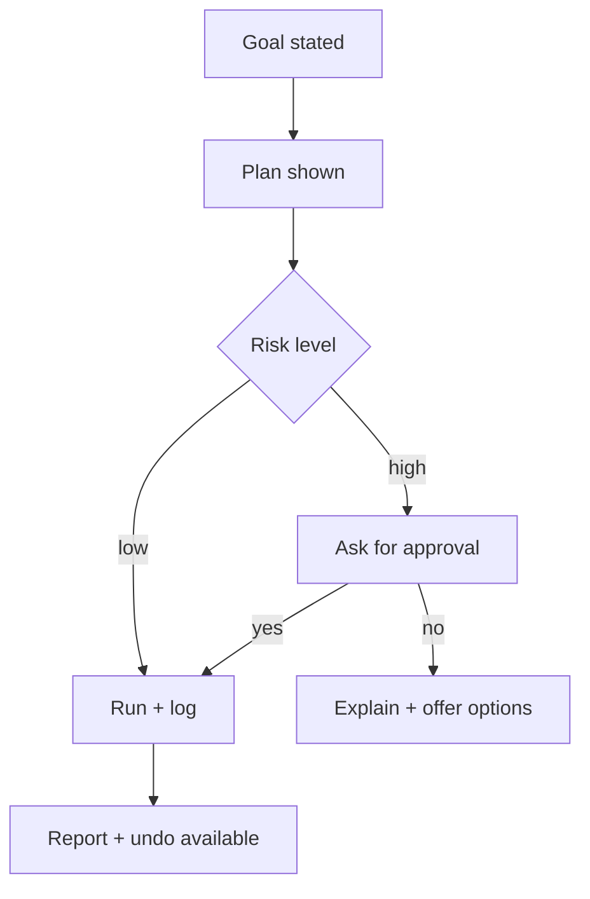

Forecasts about design are mostly marketing with a calendar attached. This chapter takes a more modest approach. It sorts what is changing into three piles: shifts that follow from a real change in what software does, shifts that are fashion, and parts of the craft that will outlast both. Predictions are stated as bets, with the reasoning shown, so you can disagree with the reasoning.

::media{key="ux-guide/future-of-ux-design-hero" alt="Three overlapping layers labeled durable, shifting and fashionable" caption="Three layers of change" ratio="16:9"}

## Durable, Shifting, Fashionable

**Durable** things follow from human limits. People have finite attention, limited working memory, a need to feel in control, and a strong preference for the familiar. Interfaces that respect those limits will keep working. Hierarchy, feedback, clarity and consistency are not going out of date.

**Shifting** things follow from changes in capability. When software can plan and act on its own, the interface has to expose different things: intent, progress, authority, reversibility. That is a genuine redesign of the interaction model, not a new coat of paint.

**Fashionable** things follow from taste. A particular gradient, a card radius, an animation style. They date quickly and cost little to adopt or drop. Do not confuse them with the other two.

The test when you read a trend: does it follow from a human limit, a capability change, or taste? Spend your effort in that order.

## Agentic Interfaces

The largest shift in interaction is software that does things instead of waiting to be told each step. A person states a goal; the system plans, calls tools, changes things, and reports. The design problem moves from "how do I perform this task" to "how do I delegate it, supervise it and recover from it."

A set of principles has emerged from building these systems, and they are consistent enough to treat as a working checklist.

**Legibility.** The user should be able to see what the agent is doing and has done, in language they understand. A step log that names actions and targets beats a spinner and a final message. People cannot trust what they cannot inspect.

**Scoped authority.** Make the boundary of what the agent may do explicit and adjustable. Read-only access, access to one workspace, access to production. The default should be the narrowest scope that lets the task succeed, with a clear path to widen it.

**Approvals proportional to risk.** Low-risk, reversible actions should not interrupt. High-risk or irreversible ones should. Prompting for everything trains people to click through; prompting for nothing erodes trust. Watch approval rates and timing: instant approvals on everything suggest the prompt has lost its meaning.

**Interruptibility.** Users must be able to stop, redirect or take over mid-task, and the agent must be able to explain where it stopped.

**Undo and audit.** Reversibility changes behavior: people try more when they can take it back. Pair undo with a durable record of who or what changed something, when and why.

**Honest uncertainty.** When the agent is unsure, guessing, or working from stale information, the interface should say so. Confidence that is not earned is the fastest way to lose a user.

**Handoff quality.** When the agent cannot finish, the handoff should state what was done, what remains, and what it needs. A failure that leaves the user to reconstruct state is a design defect.

## Generative and Adaptive Interfaces

Interfaces that are assembled at the moment of use, in response to context or request, are now technically plausible. The promise is real: surfaces that fit the task. The risks are equally real: inconsistency, unpredictability, and the loss of a stable mental model.

The sensible approach is constrained generation. The system composes interfaces from a fixed vocabulary of components and tokens, within layout rules, rather than inventing arbitrary UI. That keeps the result accessible, on-brand and predictable, while letting the arrangement adapt.

Principles that keep generative UI trustworthy:

- **A stable core.** Navigation, identity and primary actions stay put. Adaptation happens inside a frame.
- **Explainable change.** If the interface changed itself, the user can see why and revert it.
- **Accessibility is non-negotiable and automatic.** Generated layouts must meet contrast, target size and focus requirements by construction, because nobody will review each one.
- **Tokens as the guardrail.** If every color and spacing value comes from a theme, generated output inherits the theme's coherence for free.

## Conversational and Multimodal Input

Text, voice, images, files and direct manipulation are converging in one interaction. A person might sketch, speak and type in a single request. The design questions are about choosing the right channel and combining them well.

- Voice is excellent for hands-busy and eyes-busy contexts and poor for precision and privacy.
- Conversation is excellent for open-ended goals and poor for browsing a known set of options. A chat box is not a navigation system.
- Direct manipulation remains the best way to make precise visual changes. The strongest products let people point at something and describe a change, combining the channels.

Do not replace a well-designed control with a prompt box because it seems modern. Add the prompt box where free-form intent is the thing people actually have.

## Spatial and Ambient Computing

Headsets, glasses and ambient devices introduce depth, gaze and gesture as inputs, and real-world context as a layout constraint. The craft problems are familiar in new clothes: target size and distance, comfort over long sessions, feedback for non-touch input, avoiding sensory overload. Most teams will encounter this by adapting an existing product, so the practical skill is knowing which interactions translate and which do not.

## Design and Code Are Converging

The handoff, in which a designer produces a picture and an engineer re-creates it, is eroding. Shared tokens, component libraries and code-aware design tools mean a design decision can be expressed once and consumed by both.

Practical consequences for teams:

- **Tokens become an API.** Changing a token is a product release. It deserves versioning and a deprecation path.
- **Components own their states.** A component that ships with complete states and accessibility behavior removes whole categories of review.
- **The design engineer role grows.** People who can reason about layout, motion and semantics in code are unusually valuable, especially on small teams.
- **Prototypes get real.** It is increasingly cheaper to build the interaction than to simulate it.

## Personalization and Privacy

Interfaces can adapt to the person: surfacing what they use, hiding what they do not, adjusting density and language. Done well, it reduces effort. Done carelessly, it creates surprise, filter bubbles and surveillance feelings.

Keep adaptation inspectable and reversible, base it on the minimum necessary data, prefer on-device or session-scoped adaptation where possible, and never make a core function move without warning. Predictability is a feature.

## Accessibility Becomes a Requirement

Accessibility has been moving from guideline to obligation for years. The European Accessibility Act began applying to many consumer-facing digital products and services in June 2025, and accessibility lawsuits are routine in other markets. WCAG 2.2 added criteria around target size, focus visibility and authentication that many products still miss.

The efficient response is to treat accessibility as a property of the system rather than a review stage. Accessible components, token-level contrast guarantees, keyboard behavior tested once in the component, and a short manual audit before release. It costs a fraction of retrofitting, and it improves the product for everyone.

## Performance and Sustainability

Speed is an experience quality people feel before they can describe it. Core Web Vitals give a shared language: Largest Contentful Paint under 2.5 seconds, Interaction to Next Paint under 200 milliseconds, Cumulative Layout Shift under 0.1. As interfaces get heavier with generated content and media, the discipline of performance budgets becomes part of design, not just engineering.

There is a related and growing awareness of the energy cost of digital products. Fewer, lighter assets and less wasted computation tend to improve speed and sustainability together.

## What to Learn, What to Ignore

**Worth your time:**

- Designing for delegation: approvals, scopes, logs, undo.
- Systems thinking: tokens, components, constraints.
- Research literacy: being able to tell evidence from anecdote.
- Writing: product language is interface.
- Enough code to prototype and to understand constraints.
- Accessibility as craft.

**Worth watching without rebuilding your practice:**

- Any single tool's interface conventions, which will shift.
- Specific visual styles.
- Claims that research or design will be fully automated. Tools will absorb tasks. The job of deciding what to build, for whom, and whether it worked is not a task.

## A Note on Predictions

Anyone who tells you exactly what interfaces will look like in five years is guessing. The more reliable approach is to know the durable constraints, track real capability changes, and run small experiments cheaply. The teams that adapt best are not the ones with the best forecasts. They are the ones with the shortest loop between an idea and a test.
