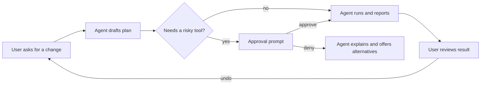

Most UX guides read like glossaries. This one is a working manual: how we move from a vague problem to a shipped interface when the product is an AI agent platform, a CMS, a theme editor and a stack of dashboards that other people have to live inside every day.

It covers the process from first question to measured result, the artifacts each stage should produce, the research and evaluation methods worth learning, and the roles that do the work. Where a method deserves the long version, there is a chapter. Where it doesn't, the hub says everything you need and moves on.

A note on voice. We build with a very small team and a lot of automation, so the advice here is biased toward things that survive that: short artifacts, cheap tests, explicit rules, and interfaces that are complete before they are clever.

::media{key="ux-guide/hub-intro-scene" alt="Opening scene for the guide" caption="Opening scene" ratio="16:9"}

## UX Fundamentals

### What Is UX Design?

UX design is the practice of shaping how a product works for the people using it, across the whole span of contact: finding it, understanding it, getting set up, doing the real job, recovering when something goes wrong, and deciding whether to come back. The unit of work is not a screen. It is a person trying to get something done in a context you do not control.

Three layers help when you are diagnosing a product. **Utility** asks whether it does something the person needs at all. **Usability** asks whether they can do it without friction, mistakes or guesswork. **Meaning** asks whether the experience earns a second visit. Teams routinely polish the third layer while the first is shaky, and the result is a beautiful product nobody can finish a task in.

The experience also includes things nobody thinks of as design. The latency of a response, the wording of a failure message, the email that arrives after a payment fails, the state of the interface while an agent is halfway through a job. In an agent platform, one of the most important experiences is what the user sees when a tool call is denied. That is UX, and it is rarely in anyone's mockups until it goes wrong.

### What Is UI Design?

UI design is the surface: layout, typography, color, spacing, components, states, motion, and the words on the controls. It answers what is on the screen, how it is arranged, and how it responds when someone touches it.

Good UI makes hierarchy obvious. A person should be able to tell, within a second or two, what is primary, what is secondary, what is destructive, and what is merely informational. They should also never meet a component in a state nobody designed. Every control ships with its full state table: default, hover, focus, pressed, disabled, loading, empty, error and success. If any of those are missing, a user will find them in production.

In a themeable product, UI design is partly the authoring of a contract rather than the painting of screens. Components do not own colors. They request roles such as base surface, inverse surface, text on base and hairline, and the active theme answers. That is a design decision with real consequences: it means a screen you never saw can still look intentional in a theme you never imagined.

### UX vs. UI

They are two views of one job, and they fail differently.

| | UX design | UI design |
|---|---|---|
| Main question | Can people get the thing done, and do they want to? | Is it clear, legible and consistent while they do it? |
| Typical outputs | Research, flows, information architecture, test findings | Layouts, components, tokens, states, motion |
| Failure looks like | Users abandon a task they wanted to complete | Users complete it but squint, hesitate or misclick |
| Evidence | Task success, drop-off, interviews | Contrast checks, consistency audits, first-click tests |

A concrete split: UX decides that an editor needs an undo that survives a page refresh, because people will experiment more freely if experiments are reversible. UI decides where the undo control sits, how it looks when there is nothing to undo, and how it announces itself to a screen reader.

You cannot repair a UX problem with UI paint. A confusing three-step setup does not become clear because the buttons are rounder. The reverse also holds: a sound flow with inconsistent spacing and unlabeled icons still feels untrustworthy.

### What Do UI/UX Designers Do?

The job, stripped of titles, is a cycle of eleven activities: frame the problem, gather evidence, structure the information, define the flows, design the interface, prototype the risky parts, test them, specify the result for engineering, review the build, measure after launch, and feed what was learned back into the next frame.

The unglamorous half is where most of the quality lives. It is the empty state, the permission-denied state, the long-name case, the 10,000-row case, the slow-network case, the error copy, the keyboard path and the focus order. A designer who only draws the happy path has done a third of the work.

On a small team one person often does all of it. That is workable if the artifacts stay small and the system does the repetitive work. It stops being workable when everything is bespoke, which is why design systems and shared tokens matter more to tiny teams than to large ones.

### Why UX Design Matters

The business argument is simple and it does not need invented statistics. Changing a flow in a prototype costs an afternoon. Changing it after it has shipped costs engineering time, migration work, support load and some amount of user trust. UX work moves discovery to the cheap end of the timeline.

The second argument is trust, and it is sharper for AI products. When software acts on someone's behalf, the interface is the only evidence they have about what it is doing. Visible status, clear approvals, honest errors and reliable undo are not decoration on an agent platform. They are the product.

The third is access. Roughly one in six people worldwide lives with a significant disability, according to the World Health Organization, and accessibility requirements are increasingly legal requirements rather than good manners. The European Accessibility Act began applying to many consumer-facing digital products and services in June 2025. Designing for keyboard, screen reader, zoom and reduced motion from the start is far cheaper than retrofitting.

::media{key="ux-guide/hub-trust-states" alt="An agent task in progress, awaiting approval, denied and completed" caption="The same task across four trust-critical states" ratio="16:9"}

## UI/UX Design Process

The process is a loop, not a ladder. It borrows the double-diamond shape: diverge to understand the problem, converge on a definition, diverge to explore solutions, converge on one to ship. Then measure, and go around again with better questions.

We work in seven stages. Strategy decides why. Definition decides what. Analysis learns what exists. Research and methods fill the gaps. Design makes the thing. Validation checks it. Measurement tells us whether it worked.

::media{key="ux-guide/hub-process-loop" alt="Seven-stage design loop from strategy to measurement" caption="The seven-stage loop" ratio="16:9"}

### UX Strategy

Strategy is a short, falsifiable bet. Who is this for, what problem are we solving, why are we the ones to solve it, what are we explicitly not doing, and how will we know if we were right?

A useful strategy fits on one page:

- **User and context.** Who, in what situation, with what alternatives.
- **Problem.** Stated as an observed difficulty, not a missing feature.
- **Bet.** What we think will help, and why.
- **Success metric.** One primary number with a direction and a window.
- **Non-goals.** The tempting things we are leaving out.
- **Constraints.** Platform, latency, cost, legal, team size.

An illustrative example for a theme editor aimed at people who are not developers: the bet is that direct manipulation, with an agent offering suggestions in the same surface, will beat a settings form. The metric is time from opening the editor to publishing a first change. The non-goal is arbitrary custom CSS in the first version. Notice that every line can be wrong, and that is the point.

### Product Definition

Definition converts the bet into scope. We use job statements ("When I want to change how my site looks, I want to try a change without risking the live version, so I can experiment freely") because they describe motivation and context rather than a feature, and a feature list is what you write after you know the job.

From jobs we derive requirements and then sort them honestly. The Kano model is a handy lens: must-haves that cause anger when missing, performance features where more is better, and delighters nobody asks for. A small team should ship the must-haves completely and one delighter at most.

Acceptance criteria are where UX gets enforced. Ours name states, not just behavior. A feature is not done when the happy path works. It is done when the empty, loading, error and denied states exist, when there is a keyboard path, and when the copy has been read aloud by someone who did not write it.

### Analysis

Before designing anything, learn what exists. Analysis is audit work: how the current product behaves, where people leave, what they complain about, and what the constraints really are.

- **Product and UX audit.** Walk the core journeys as a new user and record friction with screenshots and severity.
- **Analytics baseline.** Funnel conversion, time to first success, feature adoption. Capture the number before you change anything, or you cannot claim a win.
- **Support and feedback mining.** Tag the last few dozen tickets and messages by theme. Repeats are signal.
- **Competitive and adjacent teardown.** Look at products solving the same job, and at products solving different jobs with a pattern you could borrow.
- **Technical constraints.** What the platform can actually do, what it costs per request, and what is slow.

The output is a ranked list of problems with the evidence attached, plus a baseline. If the list has no evidence, it is a list of opinions.

### UX Research & Methods

Pick the method from the question, not from habit. The useful axes are generative versus evaluative (are we discovering or checking?), qualitative versus quantitative (why versus how many?), and attitudinal versus behavioral (what people say versus what they do).

| The question | A good fit |
|---|---|
| What are people trying to do, and how? | Interviews, contextual inquiry, diary studies |
| Where do they get stuck? | Moderated usability tests, session replays |
| What do they call things? | Card sorting |
| Can they find it? | Tree tests, first-click tests |
| How many, how often, how fast? | Product analytics, surveys, benchmarks |
| Does this idea resonate at all? | Five-second tests, fake-door tests |

Small samples are fine for finding problems and bad for sizing them. Five or six participants will surface most of the major usability issues in a single design; they will tell you nothing reliable about percentages. The chapters on [user testing](/blog/ux-guide/user-testing) and [behavior data](/blog/ux-guide/user-behavior-data) go deeper on each side.

### UI/UX Design

This is the making stage, and it runs from structure to surface in a fixed order, because each step constrains the next.

1. **Information architecture.** What things exist and how they relate. Name them in users' words.
2. **Flows.** The paths between states, including the unhappy ones.
3. **Wireframes.** Layout and priority, in grayscale, with real content.
4. **Visual design.** Hierarchy, type, spacing and color, expressed through tokens.
5. **Components.** Reusable parts with complete state tables.
6. **Prototype.** Enough interactivity to test the risky decision.

The principles that earn their keep are hierarchy, consistency, feedback, constraint and progressive disclosure. Show what matters now, hide what matters later, and make the next action obvious. Design for the extremes, not the median: the very long name, the empty account, the table with ten thousand rows, the connection that drops mid-action.

Accessibility lives inside this stage, not after it. Text at 4.5:1 contrast against its background, interactive targets at least 24 by 24 CSS pixels under WCAG 2.2 (and closer to 44 for comfortable touch), visible focus that is not hidden behind sticky headers, and meaning that never depends on color alone.

### Validation

Validate with the cheapest artifact that can answer the question. A paper sketch can tell you whether the structure makes sense. A click-through can tell you whether the flow is followable. A coded prototype with fake data can tell you whether an interaction feels right. A staged build behind a flag can tell you how it holds up on real content.

Decide the pass criteria before the session. "Four of five participants publish a change without help" is a criterion. "People seemed to like it" is a mood.

Run an accessibility pass every time, and keep it small and repeatable: complete the main task using only the keyboard, run a screen reader through the primary flow, zoom to 200 percent and 400 percent and check reflow, and turn on reduced motion. Then review the build with the engineer who wrote it. The differences between the design and the build are usually informative, not embarrassing.

### How to Measure UX

Four families of measures cover almost everything.

- **Behavioral:** task success rate, time on task, error rate, feature adoption, retention.
- **Attitudinal:** System Usability Scale (a ten-question survey scored 0 to 100, with a long-run average near 68), the Single Ease Question after a task, CSAT, NPS.
- **Performance:** Largest Contentful Paint under 2.5 seconds, Interaction to Next Paint under 200 milliseconds, Cumulative Layout Shift under 0.1.
- **Business:** conversion, activation, support volume, revenue per account.

Google's HEART framework organizes them by what you care about: Happiness, Engagement, Adoption, Retention and Task success. Pick one primary metric per initiative, add a guardrail or two so you do not win one number by damaging another, and instrument before launch so day one has data.

Benchmarks matter less than direction. Compare against your own last release.

## UI/UX Deliverables

A deliverable is a tool for communication, not proof of effort. Produce the ones that change a decision or unblock a person, and skip the rest.

### Design Systems & Pattern Libraries

A design system is tokens, components, patterns and the documentation and rules that keep them coherent. A pattern library is the narrower thing: a catalog of reusable components and their usage notes. The system adds the decisions behind them.

Tokens come in tiers. **Primitive** tokens are raw values (a specific gray, a spacing step). **Semantic** tokens are roles (surface, text, hairline, accent). **Component** tokens bind a role to a part (button background). Components should only reference semantic or component tokens. That one rule is what makes theming possible.

```css
:root {
  /* semantic roles: the only things components may reference */
  --surface-base: var(--theme-surface-base);
  --surface-inverse: var(--theme-surface-inverse);
  --text-on-base: var(--theme-text-on-base);
  --text-on-inverse: var(--theme-text-on-inverse);
  --hairline-on-inverse: var(--theme-hairline-on-inverse);
}
```

Governance is the unglamorous part: how a change is proposed, who reviews it, how it is versioned, how deprecated parts are retired. A system that nobody can safely change gets forked, and a forked system is two systems.

### UI/UX Research Document

A research document records what you set out to learn, how, with whom, what you found, how confident you are, and what it implies. One page for the summary, evidence linked underneath.

Keep the questions at the top. Keep the findings separate from the interpretation. And say what you did not look at, because the next reader will assume silence means coverage.

### User Research Takeaways

Takeaways turn raw observation into something a team can act on. We use a three-part form: **observation** (what happened, with a timestamp or a quote), **insight** (why it matters), **implication** (what we should do about it).

Weak takeaway: "Users want it to be faster." Strong takeaway: "Four of six participants paused for several seconds after pressing Publish with no indication anything was happening, then pressed it again. Implication: show progress immediately and disable the control while the action runs."

Group by affinity, rank by frequency and severity, and keep the original quotes within reach. A takeaway no one can trace to evidence will not survive its first challenge.

### User Flow Document

A flow shows how a person moves through a task: entry points, decisions, system responses, and exits, including failure. In a product where software acts autonomously, add lanes for each actor so responsibility is visible.



::media{key="ux-guide/hub-flow-example" alt="User, agent and approval lanes in a tool-approval flow" caption="A flow with lanes for each actor" ratio="16:9"}

Draw the unhappy branches first. They are where trust is made or lost.

### Wireframes

Wireframes settle structure, hierarchy and content priority before anyone argues about color. Keep them grayscale, use real content, and annotate behavior in words next to the shapes.

Start low fidelity so changing your mind is cheap. Move to mid fidelity once the structure holds, with real labels, real data lengths and real states. Resist high fidelity early; it invites feedback about typefaces when you needed feedback about order.

### Interactive Prototype

A prototype should be exactly as real as the question requires. To test whether a flow is followable, linked frames are enough. To test whether a drag interaction feels right, you need it coded. For AI products, a very useful trick is the Wizard of Oz prototype, where a person behind the curtain plays the agent so you can learn how people react to its behavior before you build it.

For us the cheapest prototype is often the real component with fake data, since it inherits the real tokens and the real keyboard behavior. Time-box it, and throw it away on purpose.

### User Testing Report

A good report is short. Summary of what we learned, what was tested and with whom, findings ranked by severity with evidence attached, recommendations, and what we did not test.

Severity on a zero-to-four scale (not a problem to usability catastrophe) keeps debates short. Attach a clip or a quote to every finding above a two. The report is not a transcript of the sessions. It is an argument, with evidence, about what to change first.

### Common UI Elements

The standard parts are worth knowing by job rather than by name.

| Job | Elements |
|---|---|
| Navigate | Top bar, sidebar, tabs, breadcrumbs, pagination |
| Enter data | Text field, select, combobox, checkbox, radio, toggle, slider, file upload |
| Act | Primary, secondary and destructive buttons, menus, links |
| Give feedback | Inline validation, toast, banner, progress, skeleton |
| Group | Card, table, list, accordion |
| Interrupt | Modal, drawer, popover, tooltip |

A few decisions come up constantly. Use a toggle for an immediate change and a checkbox for something submitted later. Prefer inline feedback to a toast when the message is tied to a specific control, because toasts vanish before they can be read. Prefer a drawer to a modal when the person needs the page behind it for reference. Choose destructive styling for actions that destroy data, and always offer undo or a confirmation proportional to the damage.

### UI Animations

Motion earns its place when it orients, confirms, or shows cause and effect. A panel that slides in from the edge it was summoned from explains where it lives. A button that changes state under the finger confirms the press. Anything purely decorative should justify itself.

Practical defaults: most interface transitions land between 100 and 300 milliseconds, ease-out for things entering, ease-in for things leaving, animate transform and opacity rather than layout properties, and honor the reduced-motion preference by replacing movement with a simple fade or nothing at all. Anything that takes over a second needs progress, not a spinner.

A useful anatomy for small interactions is trigger, rules, feedback and loops. Take a streaming indicator on an agent response: the trigger is a submitted message, the rules decide what shows while the model is thinking versus writing, the feedback is the moving cue, and the loop is what happens when a response runs long.

## UX Design Methods

Methods are tools with specific jobs. This section gives you the short version of each and points to a chapter where there is more.

### Value Proposition

A value proposition states who it is for, what they get, and why it beats their current way of doing it, in a sentence a stranger could repeat. Write one for the thing you are building, then test it before you build further. A five-second test (show the page, ask what it is for) and a fake-door test (offer the feature, measure clicks, explain honestly afterward) are both cheap.

If you cannot write the sentence, you do not have a proposition yet. You have a feature.

### Customer Journey Maps

A journey map lays out what a person does, thinks and feels across the stages of reaching a goal, with the touchpoints and the pain along the way. It is a tool for finding the gaps between teams' views of the product. See the full chapter on [customer journey mapping](/blog/ux-guide/customer-journey-map).

### User Personas

A persona is a research-based model of a group of users, used to keep decisions grounded. The failure mode is decoration: a stock photo, a name and a hobby, with nothing a designer can use. See [user personas that change decisions](/blog/ux-guide/user-personas).

### Heuristic Evaluation

A heuristic evaluation is an expert review against a short list of established principles. It is fast, needs no participants, and is a strong first pass before testing. Three to five reviewers working independently will find considerably more than one.

Jakob Nielsen's ten heuristics are still the standard checklist. Here they are with a product lens:

| Heuristic | What it looks like when it fails |
|---|---|
| Visibility of system status | A long agent run with no visible progress or step log |
| Match with the real world | Internal jargon in the settings labels |
| User control and freedom | No way to cancel or undo a started action |
| Consistency and standards | The same action named three ways across screens |
| Error prevention | A destructive action one click away, no confirmation |
| Recognition over recall | Making people remember a command instead of showing it |
| Flexibility and efficiency | No shortcuts for the people who use it eight hours a day |
| Minimalist design | Every setting on one page at equal weight |
| Help with errors | "Something went wrong" with no cause or next step |
| Help and documentation | Docs that describe features, not tasks |

Rate each issue for severity, merge duplicates, and hand the team a short list in priority order.

### Product Roadmap

A roadmap communicates direction and priority, not a delivery contract. For small teams, a Now, Next, Later layout beats date-based charts because it admits uncertainty honestly. The chapter on [product roadmaps for small teams](/blog/ux-guide/product-roadmap) covers outcome-based items and how to say no.

### Usability Testing

Watch representative people try to do realistic tasks, say little, and note where they struggle. It is the single highest-value research habit. Read the long form in [user testing: methods, sample sizes and session craft](/blog/ux-guide/user-testing).

### Guerrilla Testing

Guerrilla testing is usability testing stripped to the bone: short, informal sessions with whoever is available, in a public place or a hallway or a community channel, often with a small thank-you. It trades participant fit for speed.

It is a good fit for early concepts, navigation labels and first-impression questions. It is a poor fit for specialist workflows, because a passerby does not know your domain. Keep it to five minutes, one question, and a clear script. Write down what you saw rather than what you hoped to see, and treat results as directional.

A sound routine: prepare three tasks and a one-line introduction, ask permission and say plainly that you are testing the product and not the person, watch silently, ask "what were you expecting?" only after a stumble, and finish with one open question. Ten sessions in an afternoon will tell you whether the concept is clear.

### Task Analysis

Task analysis breaks a goal into the steps, decisions and knowledge it takes to complete it, so you can design for the real work instead of the imagined one. The chapter on [task analysis](/blog/ux-guide/ux-task-analysis) walks through a hierarchical breakdown and where the design opportunities hide.

## Essential Takeaways for UI/UX Designers

### How to Become a UI/UX Designer

There is no single required path. People arrive from graphic design, front-end development, research, writing and product management, and plenty are self-taught. What matters is a body of work that shows how you think. The chapter on [becoming a UI/UX designer](/blog/ux-guide/roadmap-to-becoming-uiux-designer) lays out a twelve-month plan.

### Skills for a UX Designer

Three groups. **Craft:** layout, typography, color, prototyping, component thinking. **Thinking:** problem framing, systems thinking, research literacy, writing clearly. **Collaboration:** explaining a decision, taking critique, working with engineers on what is feasible.

Add enough code to read a component and understand a constraint. You do not have to be an engineer. You do have to know why a design that looks simple is expensive to build.

### What Is a UI Designer?

A UI designer owns the visual and component layer: hierarchy, type, spacing, color, iconography, states and the system that keeps them consistent. The deliverable is not a pretty frame. It is a set of parts and rules an engineer can build from without guessing.

### What Is an Interaction Designer?

An interaction designer owns behavior: what happens on input, how state changes, what feedback appears and how it feels over time. They think in transitions, timing and edge cases. The longer description is in [what an interaction designer actually does](/blog/ux-guide/interaction-designer).

### What Is a UX Researcher?

A UX researcher designs studies, recruits participants, runs sessions, analyzes evidence and turns it into decisions. They are as much a translator as an investigator. A good researcher makes the team's assumptions testable and keeps them honest about what the evidence does and does not say.

### What Is a UX Writer?

A UX writer owns the language of the product: labels, instructions, empty states, errors, confirmations and tone. Words are interface. A well-written error message that names the cause and the next step does more for trust than most visual polish.

### What Is a Product Designer?

A product designer takes responsibility for the outcome, from problem framing to shipped result, drawing on research, interaction and UI skills as needed. It is the closest match to what a small team needs from one person. See [what a product designer actually does](/blog/ux-guide/product-designer).

### Key UI/UX Design Tools

Tools change; the jobs do not. Think by job.

- **Design and prototyping:** Figma, Penpot (open source), Framer. For us, coded prototypes in the real component library are often faster.
- **Diagramming and thinking:** FigJam, Excalidraw, Mermaid for flows that live next to the code.
- **Research:** a video-call tool for moderated sessions, a survey tool, a transcript and tagging tool, and product analytics with session replay.
- **Accessibility:** axe DevTools, Lighthouse, WAVE, a contrast checker, and a screen reader (VoiceOver, NVDA).
- **Collaboration with agents:** an AI agent is a strong partner for first drafts of states, copy variants, test scripts and token audits. It is a weak substitute for watching a real person use the thing.

### Best UX Books to Read

Start with the classics on how people and objects interact, add one on research, one on systems, and one on visual craft. We keep an annotated list in [the UX reading list](/blog/ux-guide/ux-books).

### Wrapping Up

UX design is a discipline of making hidden costs visible: confusion, hesitation, abandoned tasks, support load, lost trust. The process is a loop, the deliverables are tools, the methods are matched to questions, and the roles blur on small teams. Learn the loop, then shorten it until you can run it in a day.

## Frequently Asked Questions About UI/UX Design

### What are the five elements of UX design?

Jesse James Garrett's model describes five planes that build on each other. **Strategy** is what you and your users want. **Scope** is the features and content that follow. **Structure** is how those pieces are organized and how people move between them. **Skeleton** is the layout of interface, navigation and information. **Surface** is the visible sensory design. Decisions at the lower planes constrain the upper ones, so a problem at the surface is often a strategy problem in disguise.

### What are the laws of UX?

A handful of well-supported observations, used as lenses and not as commandments.

- **Jakob's Law:** people spend most of their time on other products, so they expect yours to work like those.
- **Hick's Law:** decision time grows with the number and complexity of choices.
- **Fitts's Law:** time to hit a target depends on its distance and size.
- **Miller's Law:** working memory holds a limited number of chunks. It is about memory, not a rule for menu length.
- **Postel's Law:** be liberal in what you accept and conservative in what you send.
- **Tesler's Law:** complexity cannot be removed, only moved. Decide who carries it.
- **Doherty Threshold:** responses under about 400 milliseconds keep people in flow.
- **Peak-end rule:** people judge an experience by its most intense moment and its ending.
- **Aesthetic-usability effect:** attractive interfaces are perceived as easier to use.
- **Von Restorff effect:** the item that differs from its neighbors is the one remembered.

### What are the common myths about UX?

That it is only about looks, that users know what they want, that more features means more value, that people never scroll, that five users is always enough. We take them apart in [UX myths worth retiring](/blog/ux-guide/ux-myths).

### What are the latest UX design trends in 2026?

The durable shifts are interfaces for autonomous agents (delegation, approval, audit trails, undo), generative and adaptive interfaces constrained by design tokens, multimodal input, design and code converging around shared tokens, personalization that respects privacy, and accessibility moving from guideline to legal requirement. The fashionable layer on top changes every season. See [where UX is heading](/blog/ux-guide/future-of-ux-design) for how to tell them apart.

## More on UI/UX

Keep going with [the disciplines inside UX](/blog/ux-guide/ux-disciplines), [reading user behavior data](/blog/ux-guide/user-behavior-data), and [UX myths worth retiring](/blog/ux-guide/ux-myths).
